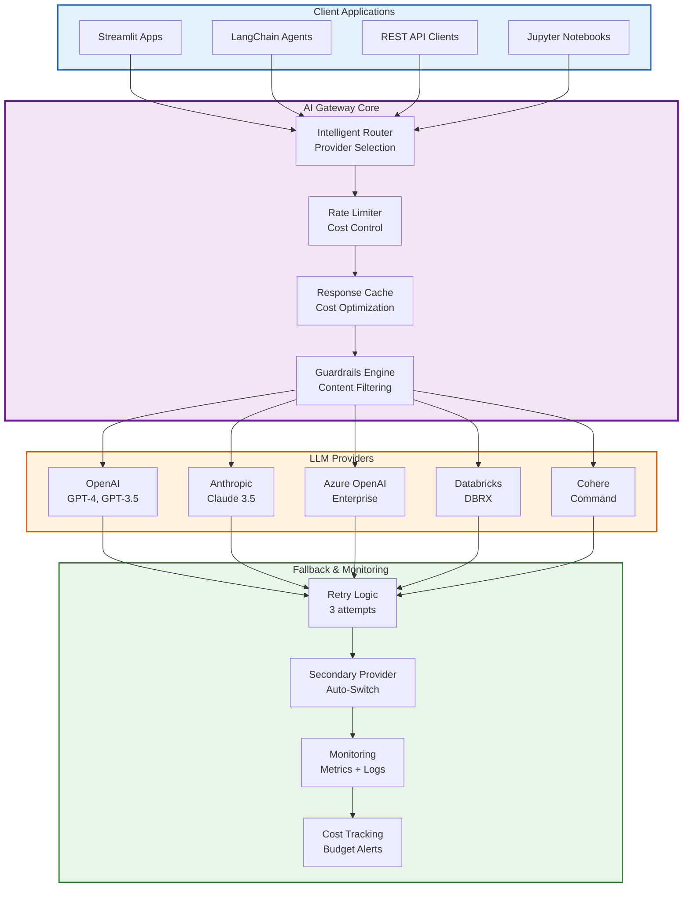
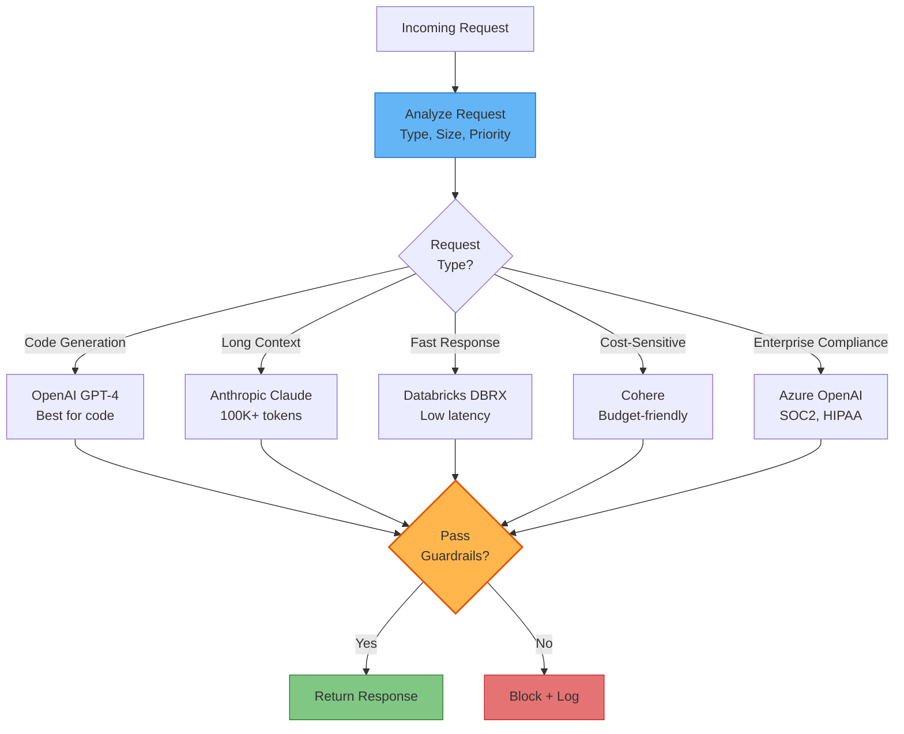
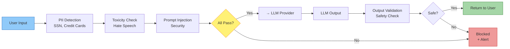
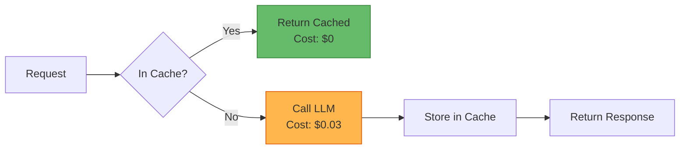
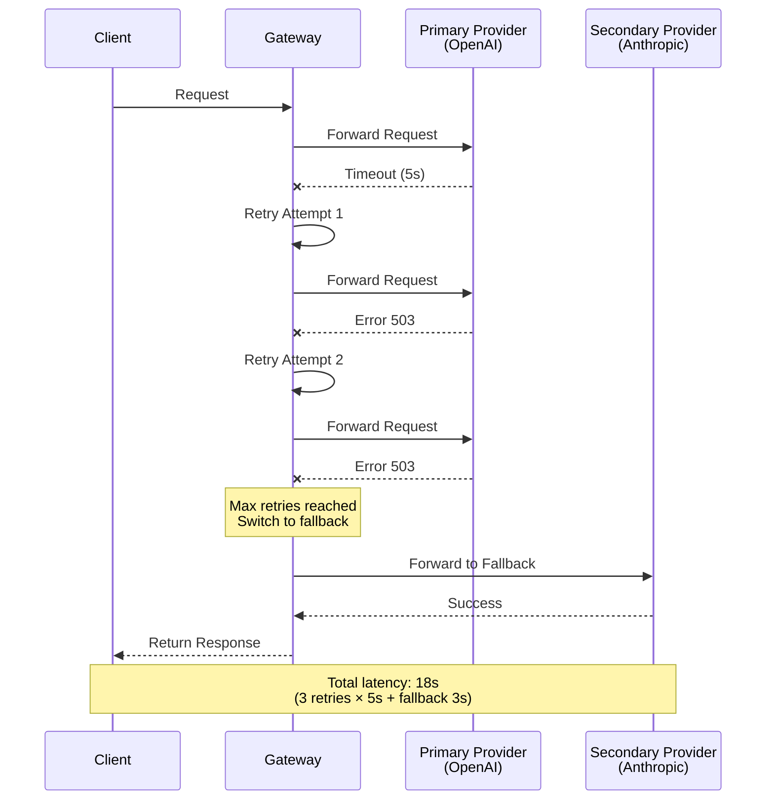
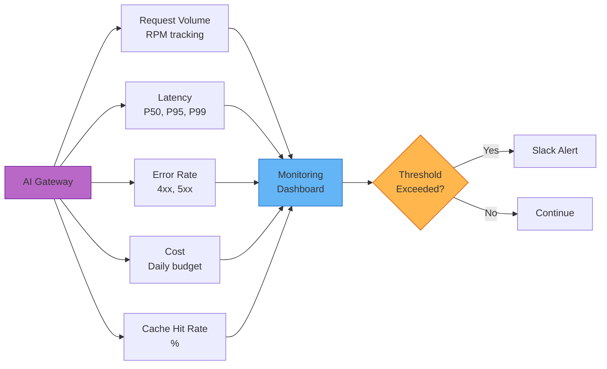

# AI Gateway Integration Architecture
## 5 LLM Providers | Intelligent Routing | Guardrails | Fallback Logic

Enterprise-grade AI Gateway for multi-provider LLM orchestration with cost optimization, guardrails, and high availability.

---

## AI Gateway System Architecture



---

## Routing Decision Logic



---

## Guardrails Framework

### **Content Filtering Layers**


### **Guardrail Configuration**
* **PII Detection**: Redact SSN, credit cards, emails
* **Toxicity Threshold**: Block if score > 0.7
* **Prompt Injection**: Pattern-based detection
* **Output Length**: Max 4096 tokens
* **Forbidden Terms**: Configurable blocklist

---

## Cost Optimization Strategies

### **1. Response Caching**


**Cache Hit Rate**: ~40% (saves $1,200/month)

### **2. Provider Cost Matrix**

| Provider | Input (1K tokens) | Output (1K tokens) | Latency | Best For |
|----------|-------------------|--------------------|---------| ---------|
| **GPT-4** | $0.03 | $0.06 | Medium | Complex reasoning |
| **GPT-3.5** | $0.001 | $0.002 | Fast | Simple tasks |
| **Claude** | $0.015 | $0.075 | Medium | Long context |
| **DBRX** | $0.00075 | $0.00225 | Fast | Cost-sensitive |
| **Cohere** | $0.001 | $0.002 | Fast | Budget workloads |

---

## High Availability & Fallback



**Fallback Configuration**:
* **Max Retries**: 3
* **Retry Backoff**: Exponential (1s, 2s, 4s)
* **Failover Providers**: Defined per route
* **Circuit Breaker**: After 5 consecutive failures

---

## Monitoring & Observability

### **Key Metrics**


### **Alert Thresholds**
* **Cost**: Daily budget > $100
* **Error Rate**: > 5% for 5 minutes
* **Latency**: P95 > 10s
* **Rate Limit**: 90% of quota consumed

---

## Implementation Files (19 files)

```
6_Industry_Patterns/04_AI_Gateway/
├── gateway_config.yaml              # Main configuration
├── routing_logic.py                 # Provider selection
├── fallback_strategy.py             # HA logic
├── rate_limiter.py                  # Cost control
├── guardrails_engine.py             # Content filtering
├── provider_openai.py               # OpenAI integration
├── provider_anthropic.py            # Anthropic integration
├── provider_azure.py                # Azure OpenAI
├── provider_databricks.py           # DBRX models
├── provider_cohere.py               # Cohere models
├── monitoring_dashboard.py          # Observability
├── cost_tracking.py                 # Budget management
└── prompt_templates/                # 6 template files
    ├── code_review.txt
    ├── summarization.txt
    ├── classification.txt
    ├── extraction.txt
    ├── generation.txt
    └── conversation.txt
```

---

## Related Documentation

* [Industry Patterns Architecture](./04_Industry_Patterns_Architecture.md)
* [Industry Patterns Catalog](./07_Industry_Patterns_Catalog.md)
* [AI Agent Templates](./AI_Agent_Templates_Architecture.md)

---

**Version**: 1.0  
**Last Updated**: 2026-08-03  
**Providers**: 5 (OpenAI, Anthropic, Azure, Databricks, Cohere)  
**Status**: Production AI Gateway Active
