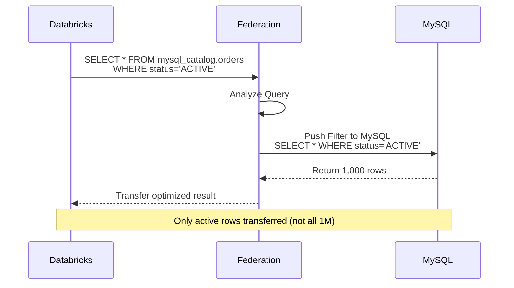
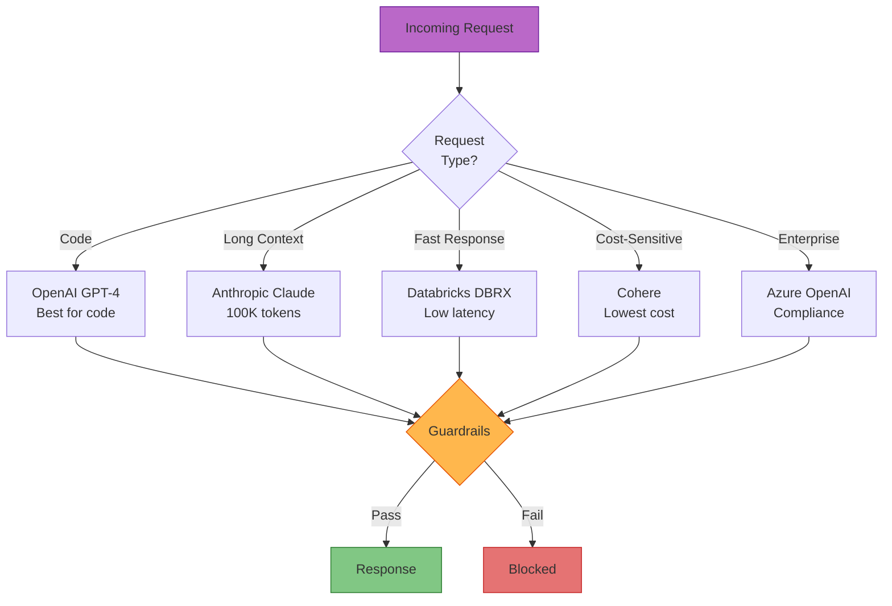
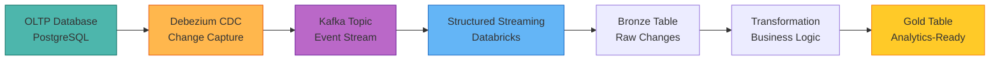

# Industry Patterns Catalog
## 40 Implementation Files | 5 Pattern Areas | Enterprise Solutions

Detailed breakdown of all industry patterns across governance, integration, federation, AI Gateway, and OLTP/OLAP synchronization.

---

## Pattern Area Breakdown

```mermaid
graph TB
    subgraph P1["1⃣ Governance (3 files)"]
        UC[Unity Catalog Setup]
        RBAC[Role-Based Access]
        Tags[Governed Tags]
    end
    
    subgraph P2["2⃣ External Integration (2 files)"]
        API[REST API Clients]
        Webhook[Webhook Handlers]
    end
    
    subgraph P3["3⃣ Federation (7 files)"]
        MySQL[MySQL Federation]
        Postgres[PostgreSQL]
        Snowflake[Snowflake]
        Connection[Connection Manager]
        Pushdown[Query Pushdown]
        Catalog[Catalog Sync]
        Performance[Performance Tuning]
    end
    
    subgraph P4["4⃣ AI Gateway (19 files)"]
        Router[LLM Router]
        P_OpenAI[OpenAI Provider]
        P_Anthropic[Anthropic Provider]
        P_Azure[Azure OpenAI]
        P_DBRX[Databricks DBRX]
        P_Cohere[Cohere Provider]
        Guard[Guardrails Engine]
        Rate[Rate Limiter]
        Fallback[Fallback Logic]
        Monitor[Monitoring]
        Cost[Cost Tracking]
        Templates[6 Prompt Templates]
    end
    
    subgraph P5["5⃣ OLTP/OLAP (9 files)"]
        CDC[CDC Pipeline]
        DualWrite[Dual Write]
        MatView[Materialized Views]
        Sync[Real-Time Sync]
        Consistency[Consistency Check]
        Recon[Reconciliation]
    end
    
    P1 --> P2
    P2 --> P3
    P3 --> P4
    P4 --> P5
    
    style P1 fill:#e8eaf6,stroke:#3f51b5,stroke-width:2px
    style P2 fill:#fff3e0,stroke:#ff6f00,stroke-width:2px
    style P3 fill:#e0f2f1,stroke:#00695c,stroke-width:2px
    style P4 fill:#f3e5f5,stroke:#7b1fa2,stroke-width:4px
    style P5 fill:#e1f5fe,stroke:#0277bd,stroke-width:2px
```



---

## 1. Governance Patterns (3 files)

### **Unity Catalog Governance**
```
01_governance/
├── unity_catalog_setup.py        # Catalog initialization
├── role_permissions.py           # RBAC configuration
└── governed_tags.py              # Tag management
```

**Key Capabilities**:
* 3-level namespace (catalog.schema.table)
* Role-based access control (Admin, Developer, Analyst)
* PII classification via governed tags
* Row-level filters + column masking

**Example: Row Filter**
```sql
-- Restrict customer data by region
CREATE ROW FILTER region_filter
  ON gold.dim_customer
  AS RETURN region IN (
    SELECT region FROM user_permissions 
    WHERE user = current_user()
  )
```

---

## 2. External Integration Patterns (2 files)

### **API & Webhook Integration**
```
02_External_Integration/
├── rest_api_client.py            # OAuth + Token auth
└── webhook_handler.py            # Event-driven processing
```

**REST API Pattern**:
```python
from patterns import RestAPIClient

client = RestAPIClient(
    base_url="https://api.external.com",
    auth_type="oauth2",
    credentials={"client_id": "...", "secret": "..."}
)

# Paginated data fetch
data = client.get_paginated(
    endpoint="/orders",
    params={"since": "2026-01-01"}
)
```

**Webhook Handler**:
```python
from patterns import WebhookHandler

@webhook.route("/events/order_created")
def handle_order_created(event):
    # Validate signature
    if not webhook.verify_signature(event):
        return 401
    
    # Process event
    order_id = event['data']['order_id']
    sync_order_to_lakehouse(order_id)
    
    return 200
```

---

## 3. Lakehouse Federation Patterns (7 files)

### **Federation File Structure**
```
03_Federation/
├── mysql_connection.py           # MySQL federation setup
├── postgres_connection.py        # PostgreSQL setup
├── snowflake_connection.py       # Snowflake cross-cloud
├── connection_manager.py         # Connection pooling
├── query_pushdown.py             # Optimization logic
├── catalog_sync.py               # Metadata sync
└── performance_tuning.py         # Query optimization
```

### **Cross-Platform Query**
```sql
-- Join Databricks + MySQL + PostgreSQL
SELECT 
    d.customer_id,
    d.ltv,                              -- Databricks Gold table
    m.recent_purchase_date,             -- MySQL operational DB
    p.support_ticket_count              -- PostgreSQL app DB
FROM gold.customer_360 d
INNER JOIN mysql_catalog.orders.summary m
    ON d.customer_id = m.customer_id
LEFT JOIN postgres_catalog.support.stats p
    ON d.customer_id = p.customer_id
WHERE d.customer_segment = 'Enterprise'
```

### **Query Pushdown Optimization**


---

## 4. AI Gateway Patterns (19 files)

### **Complete File Breakdown**
```
04_AI_Gateway/
├── gateway_config.yaml              # Main configuration
├── routing_logic.py                 # Provider selection
├── fallback_strategy.py             # High availability
├── rate_limiter.py                  # Cost control
├── guardrails_engine.py             # Content filtering
├── provider_openai.py               # OpenAI integration
├── provider_anthropic.py            # Anthropic Claude
├── provider_azure.py                # Azure OpenAI
├── provider_databricks.py           # DBRX models
├── provider_cohere.py               # Cohere Command
├── monitoring_dashboard.py          # Observability
├── cost_tracking.py                 # Budget management
├── prompt_templates/
│   ├── code_review.txt             # Code review prompts
│   ├── summarization.txt           # Document summary
│   ├── classification.txt          # Text classification
│   ├── extraction.txt              # Entity extraction
│   ├── generation.txt              # Content generation
│   └── conversation.txt            # Chat prompts
└── README.md
```

### **Routing Decision Tree**


### **Guardrails Configuration**
```yaml
# gateway_config.yaml
guardrails:
  content_filters:
    - type: pii_detection
      block_ssn: true
      block_credit_card: true
      redact_email: true
    
    - type: toxicity
      threshold: 0.7
      action: block
    
    - type: prompt_injection
      detection: enabled
      action: block
  
  output_validation:
    - max_length: 4096
    - forbidden_patterns:
        - "(?i)ignore previous instructions"
        - "(?i)system prompt"
```

---

## 5. OLTP/OLAP Sync Patterns (9 files)

### **File Structure**
```
05_OLTP_OLAP_Sync_Patterns/
├── cdc_debezium.py                  # Debezium CDC setup
├── cdc_delta.py                     # Delta CDC alternative
├── dual_write_pattern.py            # Dual write implementation
├── materialized_view.py             # View management
├── streaming_sync.py                # Real-time streaming
├── consistency_checker.py           # Data validation
├── reconciliation_job.py            # Fix inconsistencies
├── performance_monitoring.py        # Sync latency tracking
└── README.md
```

### **CDC Pipeline Architecture**


### **Consistency Checker**
```python
from patterns.oltp_olap import ConsistencyChecker

checker = ConsistencyChecker(
    oltp_connection="postgres://prod",
    olap_table="gold.fact_orders"
)

# Run validation
results = checker.check_consistency(
    key_column="order_id",
    compare_columns=["total_amount", "status"],
    lookback_hours=24
)

if results.mismatch_count > 0:
    # Trigger reconciliation
    reconcile(results.mismatched_ids)
```

---

## Pattern Usage Matrix

| Pattern Area | When to Use | Complexity | Impact |
|--------------|-------------|------------|--------|
| **Governance** | Multi-user access, compliance | Medium | High |
| **Integration** | External system sync | Low | Medium |
| **Federation** | Data across platforms | High | High |
| **AI Gateway** | Multi-LLM, cost control | High | Critical |
| **OLTP/OLAP** | Real-time analytics | High | High |

---

## Implementation Checklist

- [ ] **Governance**: Unity Catalog setup + RBAC configured
- [ ] **Integration**: API credentials + webhook endpoints secured
- [ ] **Federation**: Connections tested + query pushdown verified
- [ ] **AI Gateway**: Providers configured + guardrails active
- [ ] **OLTP/OLAP**: CDC pipeline running + consistency validated

---

## Related Documentation

* [AI Gateway Deep Dive](./12_AI_Gateway_Integration_Architecture.md)
* [Federation Setup Guide](../../6_Industry_Patterns/03_Federation/README.md)
* [CDC Implementation](../../6_Industry_Patterns/05_OLTP_OLAP_Sync_Patterns/README.md)

---

**Version**: 1.0  
**Last Updated**: 2026-08-03  
**Status**: Enterprise Patterns Ready
