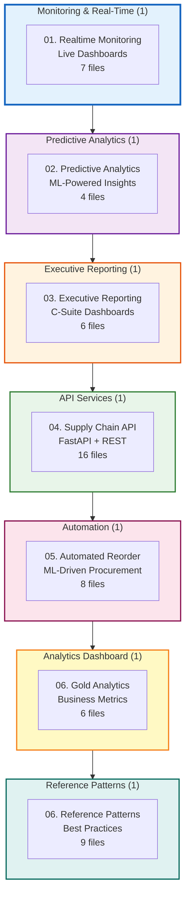
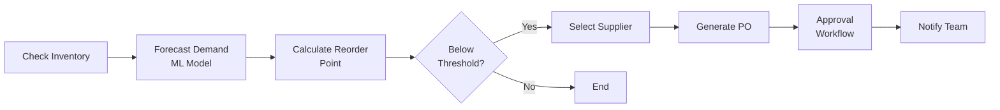

# App Templates Catalog
## 7 Production-Ready Applications | Streamlit + FastAPI | Real-Time Analytics

Complete catalog of all 7 production application templates covering monitoring, analytics, reporting, API services, and automation.

---

## Application Portfolio



---

## Application Details

### **01. Realtime Monitoring Dashboard** (7 files)
**Purpose**: Live operational monitoring with real-time KPIs

**Tech Stack**:
* Streamlit for UI
* Structured Streaming for data
* Plotly for interactive charts

**Key Features**:
* Live order volume tracking
* Real-time inventory status
* Alert threshold configuration
* Performance metrics (P95 latency, throughput)

**Files**:
```
01_realtime_monitoring/
├── app.py                    # Main Streamlit app
├── streaming_query.py        # Structured Streaming pipeline
├── metrics_calculator.py     # KPI computation
├── alert_engine.py           # Threshold monitoring
├── config.yaml              # Dashboard configuration
├── requirements.txt         # Dependencies
└── README.md               # Setup instructions
```

**Use Cases**:
* Operations team monitoring
* Incident detection
* SLA tracking

---

### **02. Predictive Analytics Dashboard** (4 files)
**Purpose**: ML-powered forecasting and predictive insights

**Tech Stack**:
* Streamlit + MLflow
* AutoML for model training
* Prophet for time series

**Key Features**:
* Demand forecasting (7-day, 30-day)
* Churn prediction
* Anomaly detection
* Model performance tracking

**Files**:
```
02_predictive_analytics/
├── app.py                    # Forecasting dashboard
├── ml_models.py             # Model loading & inference
├── data_prep.py             # Feature engineering
└── README.md
```

**Use Cases**:
* Demand planning
* Inventory optimization
* Customer retention

---

### **03. Executive Reporting Dashboard** (6 files)
**Purpose**: C-suite business metrics and strategic KPIs

**Tech Stack**:
* Streamlit with executive theme
* Delta Lake Gold tables
* High-level aggregations

**Key Features**:
* Revenue trends (MoM, YoY)
* Customer acquisition metrics
* Profitability analysis
* Strategic goal tracking

**Files**:
```
03_executive_reporting/
├── app.py                    # Executive dashboard
├── kpi_calculator.py        # Strategic metrics
├── executive_theme.css      # Custom styling
├── export_pdf.py            # PDF report generation
├── config.yaml
└── README.md
```

**Use Cases**:
* Board meetings
* Quarterly business reviews
* Investor presentations

---

### **04. Supply Chain API** (16 files)
**Purpose**: RESTful API for supply chain operations

**Tech Stack**:
* FastAPI + Uvicorn
* Unity Catalog tables
* OpenAPI documentation

**Key Features**:
* Inventory CRUD operations
* Order management endpoints
* Supplier data access
* Authentication + rate limiting

**Files**:
```
04_supply_chain_api/
├── main.py                   # FastAPI app
├── api/
│   ├── inventory.py         # Inventory endpoints
│   ├── orders.py            # Order endpoints
│   ├── suppliers.py         # Supplier endpoints
│   └── auth.py              # Authentication
├── models/
│   ├── inventory.py         # Pydantic models
│   ├── orders.py
│   ├── suppliers.py
│   └── responses.py
├── tests/
│   ├── test_inventory.py
│   ├── test_orders.py
│   ├── test_suppliers.py
│   └── test_auth.py
├── config.yaml
├── requirements.txt
└── README.md
```

**API Endpoints**:
* `GET /api/v1/inventory` - List all inventory items
* `POST /api/v1/orders` - Create new order
* `GET /api/v1/suppliers/{id}` - Get supplier details
* `PUT /api/v1/inventory/{sku}` - Update inventory levels

**Use Cases**:
* Mobile app backend
* Third-party integrations
* Automated systems

---

### **05. Automated Reorder System** (8 files)
**Purpose**: ML-driven automated procurement

**Tech Stack**:
* Scheduled jobs
* MLflow for demand forecasting
* Email/Slack notifications

**Key Features**:
* Predictive reorder point calculation
* Automatic purchase order generation
* Supplier selection logic
* Approval workflow

**Files**:
```
05_automated_reorder/
├── reorder_job.py           # Main orchestration
├── demand_forecast.py       # ML forecasting
├── reorder_calculator.py    # Reorder logic
├── supplier_selector.py     # Vendor selection
├── po_generator.py          # Purchase order creation
├── notification_service.py  # Alerts
├── config.yaml
└── README.md
```

**Workflow**:


**Use Cases**:
* Just-in-time inventory
* Automated procurement
* Stockout prevention

---

### **06. Gold Analytics Dashboard** (6 files)
**Purpose**: Business intelligence from Gold layer tables

**Tech Stack**:
* Streamlit + SQL
* Gold table aggregations
* Export to Excel/PDF

**Key Features**:
* Customer 360 view
* Product performance analysis
* Sales trend exploration
* Custom report builder

**Files**:
```
06_gold_analytics_dashboard/
├── app.py
├── sql_queries.py           # Gold table queries
├── visualization.py         # Chart generation
├── export_service.py        # Excel/PDF export
├── config.yaml
└── README.md
```

**Use Cases**:
* Ad-hoc analysis
* Business user self-service
* Departmental reporting

---

### **06. Reference Patterns** (9 files)
**Purpose**: Best practices and design patterns for Databricks apps

**Tech Stack**:
* Example implementations
* Code templates
* Architecture patterns

**Key Features**:
* Authentication patterns (OAuth, API keys)
* Error handling best practices
* Logging and observability
* Testing strategies
* Deployment patterns

**Files**:
```
06_reference_patterns/
├── auth_patterns.py         # Authentication examples
├── error_handling.py        # Error pattern examples
├── logging_config.py        # Observability setup
├── testing_framework.py     # Test patterns
├── deployment_config.yaml   # CI/CD examples
├── caching_strategies.py    # Performance patterns
├── rate_limiting.py         # API protection
├── best_practices.md        # Documentation
└── README.md
```

**Use Cases**:
* New app development
* Code review standards
* Team training

---

## Application Comparison Matrix

| App | Users | Complexity | Deployment | Update Frequency |
|-----|-------|-----------|------------|------------------|
| **Realtime Monitoring** | Ops Team | Medium | Always-on | Real-time |
| **Predictive Analytics** | Analysts | High | On-demand | Daily |
| **Executive Reporting** | C-Suite | Low | Scheduled | Weekly |
| **Supply Chain API** | Systems | High | Production | Real-time |
| **Automated Reorder** | Procurement | Medium | Scheduled | Hourly |
| **Gold Analytics** | Business Users | Low | On-demand | Ad-hoc |
| **Reference Patterns** | Developers | N/A | Documentation | As needed |

---

## Quick Start Guide

### **Deploy Any App Template**
```python
# 1. Clone template
from templates import deploy_app

# 2. Configure
app_config = {
    "template": "realtime_monitoring",
    "catalog": "skillaipath_main",
    "schema": "gold",
    "port": 8501
}

# 3. Deploy
deploy_app.launch(config=app_config)
# App running at http://localhost:8501
```

---

## Related Documentation

* [App Templates Architecture](./App_Templates_Stack.md)
* [API Documentation](../../5_App_Templates/04_supply_chain_api/README.md)
* [Deployment Guide](../../5_App_Templates/99_orchestration/)

---

**Version**: 1.0  
**Last Updated**: 2026-08-03  
**Total Apps**: 7 production templates  
**Total Files**: 56 across all templates  
**Status**: Production Ready
