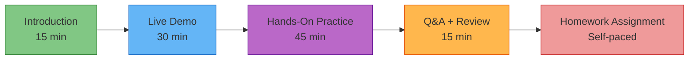
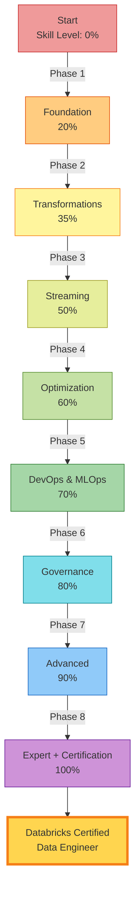
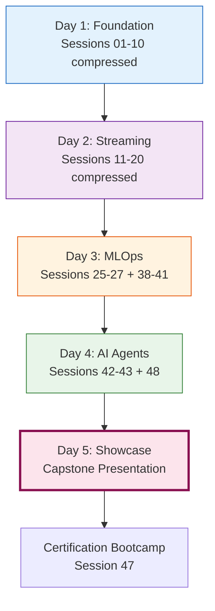

# Training Sessions Architecture
## 48 Structured Sessions | Engineering Iteration Model | Comprehensive Databricks Training

Complete architecture of 48 training sessions organized into an Engineering Iteration model (Phases 0-8) covering all Databricks platform capabilities.

---

## Session Program Overview (48 Sessions)

```
┌─────────────────────────────────────────────────────────────────────────────────────────┐
│                            TRAINING SESSIONS ARCHITECTURE                                │
│                         48 Sessions | 8-Phase Engineering Model                         │
└─────────────────────────────────────────────────────────────────────────────────────────┘

  ┌─────────────────────────┐      ┌─────────────────────────┐      ┌─────────────────────────┐
  │ PHASE 1: FOUNDATION     │      │ PHASE 2: TRANSFORMATIONS│      │ PHASE 3: STREAMING & DBT│
  │ (5 sessions)            │──────│ (5 sessions)            │──────│ (6 sessions)            │
  ├─────────────────────────┤      ├─────────────────────────┤      ├─────────────────────────┤
  │ 01. Project Setup       │      │ 06. Order Corrections   │      │ 11. AutoLoader          │
  │     UC + Git            │      │     Data Quality        │      │     Incremental Ingest  │
  │ 02. Data Generation     │      │ 07. Aggregations        │      │ 12. Trigger Modes       │
  │     Sample Datasets     │      │     Metrics             │      │     Streaming Config    │
  │ 03. Data Modeling       │      │ 08. RFM Analysis        │      │ 13. Change Feed         │
  │     Star Schema         │      │     Customer Scoring    │      │     CDC Patterns        │
  │ 04. SCD2                │      │ 09. Workflows           │      │ 14. Troubleshooting     │
  │     Customer Dimension  │      │     Job Creation        │      │     Debug Techniques    │
  │ 05. Star Schema         │      │ 10. Dependencies        │      │ 15. Explain Plans       │
  │     Complete Design     │      │     DAG Design          │      │     Query Optimization  │
  └─────────────────────────┘      └─────────────────────────┘      │ 16. Cost Awareness      │
               │                                │                    │     Resource Management │
               │                                │                    └─────────────────────────┘
               │                                │                                 │
               ▼                                ▼                                 ▼
  ┌─────────────────────────┐      ┌─────────────────────────┐      ┌─────────────────────────┐
  │ PHASE 4: OPTIMIZATION   │      │ PHASE 5: DEVOPS & MLOPS │      │ PHASE 6: GOVERNANCE     │
  │ (6 sessions)            │──────│ (6 sessions)            │──────│ (7 sessions)            │
  ├─────────────────────────┤      ├─────────────────────────┤      ├─────────────────────────┤
  │ 17. Optimization        │      │ 23. Environments        │      │ 29. Lineage Discovery   │
  │     Z-Order, Liquid     │      │     Dev/Staging/Prod    │      │     Data Flow Tracking  │
  │ 18. dbt Maintenance     │      │ 24. CI/CD               │      │ 30. Row/Column Security │
  │     Model Management    │      │     Automation Pipeline │      │     Fine-Grained Access │
  │ 19. dbt Comparison      │      │ 25. MLOps Churn         │      │ 31. Federation          │
  │     dbt vs Spark SQL    │      │     Model Training      │      │     Cross-Platform      │
  │ 20. Documentation       │      │ 26. Model Deploy        │      │ 32. Delta Sharing       │
  │     Data Catalog        │      │     Serving Endpoints   │      │     External Sharing    │
  │ 21. Demo Prep           │      │ 27. RAG Ingestion       │      │ 33. Audit Compliance    │
  │     Presentation Skills │      │     Vector Search       │      │     Compliance Reports  │
  │ 22. LinkedIn            │      │ 28. UC Governance       │      │ 34. Advanced Streaming  │
  │     Portfolio Building  │      │     Security            │      │     Multi-Hop           │
  └─────────────────────────┘      └─────────────────────────┘      │ 35. Stream Joins        │
               │                                │                    │     Complex Patterns    │
               │                                │                    └─────────────────────────┘
               │                                │                                 │
               ▼                                ▼                                 ▼
  ┌─────────────────────────┐      ┌──────────────────────────────────────────────────────────┐
  │ PHASE 7: ADVANCED       │      │ PHASE 8: AI APPS & CERTIFICATION                         │
  │ (6 sessions)            │──────│ (10 sessions)                                            │
  ├─────────────────────────┤      ├──────────────────────────────────────────────────────────┤
  │ 36. Watermarks          │      │ 42. LangChain              47. Cert Bootcamp             │
  │     Late Data Handling  │      │     Agent Building             Exam Preparation          │
  │ 37. Exactly-Once        │      │ 43. Multi-Agent            48. Capstone Project          │
  │     Guarantees          │      │     Orchestration              End-to-End Solution        │
  │ 38. Feature Engineering │      │ 44. Lakeview               49. 5Days Experience          │
  │     Feature Store       │      │     BI Dashboards              Community Engagement      │
  │ 39. MLflow Advanced     │      │ 45. Databricks Apps        50. Execution Guide          │
  │     Experiment Tracking │      │     Production Apps            Implementation Plan       │
  │ 40. Model Monitoring    │      │ 46. Gradio/Streamlit       51. WhatsApp Templates       │
  │     Drift Detection     │      │     UI Frameworks              Communication             │
  │ 41. Vector Databases    │      │                                                          │
  │     Similarity Search   │      │                                                          │
  └─────────────────────────┘      └──────────────────────────────────────────────────────────┘

  PROGRESSION: Phase 1 → Phase 2 → Phase 3 → Phase 4 → Phase 5 → Phase 6 → Phase 7 → Phase 8
  DURATION: 8 phases (intensive) or 12 weeks (self-paced)
```

---

## Phase Focus Areas

| Phase | Focus | Sessions | Skills Covered |
|------|-------|----------|----------------|
| **Phase 1** | Foundation | 5 | Project setup, Star schema, SCD2 |
| **Phase 2** | Transformations | 5 | Data quality, Aggregations, Workflows |
| **Phase 3** | Streaming & dbt | 6 | AutoLoader, CDC, Optimization |
| **Phase 4** | Optimization | 6 | Z-Order, dbt deep-dive, Documentation |
| **Phase 5** | DevOps & MLOps | 6 | CI/CD, Model training, RAG |
| **Phase 6** | Governance | 7 | Security, Federation, Compliance |
| **Phase 7** | Advanced Topics | 6 | Exactly-once, Feature Store, Drift |
| **Phase 8** | AI & Certification | 10 | LangChain, Apps, Capstone |

**Total**: 48 sessions across 8 phases (Engineering Iteration model)

---

## Session Format

Each session follows a consistent structure:



**Total Time**: ~2 hours per session + self-paced homework

---

## Key Session Details (Selected Examples)

### **Session 01: Project Setup**
**Objective**: Initialize Databricks workspace and project structure

**Topics**:
* Unity Catalog creation (catalog.schema.table)
* Git integration with Databricks Repos
* Folder structure and organization
* Initial configuration

**Deliverables**:
* Fully configured workspace
* Git repository connected
* Project folder structure created

---

### **Session 11: AutoLoader**
**Objective**: Implement incremental data ingestion with Auto Loader

**Topics**:
* Auto Loader concepts (file notification vs directory listing)
* Schema inference and evolution
* Checkpoint management
* Error handling

**Deliverables**:
* AutoLoader notebook for CSV/JSON files
* Checkpoint configuration
* Schema inference validation

---

### **Session 25: MLOps Churn Prediction**
**Objective**: Build end-to-end ML pipeline for churn prediction

**Topics**:
* Feature engineering from Gold tables
* Model training with AutoML / custom
* MLflow experiment tracking
* Model registration

**Deliverables**:
* Churn prediction model (registered in MLflow)
* Feature engineering notebook
* Experiment tracking dashboard

---

### **Session 31: Lakehouse Federation**
**Objective**: Query across Databricks + external databases

**Topics**:
* Connection setup (MySQL, PostgreSQL, Snowflake)
* Federated query syntax
* Query pushdown optimization
* Performance considerations

**Deliverables**:
* Federated queries across 3 systems
* Performance benchmark results
* Best practices documentation

---

### **Session 42: LangChain Integration**
**Objective**: Build a conversational AI agent with LangChain

**Topics**:
* LangChain framework overview
* Tool integration (SQL, Python)
* Vector Search for context
* Agent prompt engineering

**Deliverables**:
* LangChain agent over Unity Catalog tables
* Streamlit chat interface
* Prompt templates

---

### **Session 48: Capstone Project**
**Objective**: End-to-end solution from requirements to production

**Topics**:
* Requirements gathering
* Architecture design
* Implementation (all layers: Bronze → Silver → Gold)
* Testing and deployment
* Presentation

**Deliverables**:
* Complete solution (code + documentation)
* Architecture diagrams
* Presentation deck
* Demo video

---

## Learning Curve



---

## Session Dependencies

```mermaid
graph LR
    S01[S01: Setup] --> S02[S02: Data Generation]
    S02 --> S03[S03: Data Modeling]
    S03 --> S04[S04: SCD2]
    S03 --> S05[S05: Star Schema]
    
    S05 --> S06[S06: Corrections]
    S06 --> S07[S07: Aggregations]
    S07 --> S08[S08: RFM]
    
    S08 --> S09[S09: Workflows]
    S09 --> S10[S10: Dependencies]
    
    S10 --> S11[S11: AutoLoader]
    S11 --> S13[S13: CDC]
    
    S13 --> S18[S18: dbt]
    S18 --> S19[S19: dbt vs SQL]
    
    S19 --> S25[S25: MLOps]
    S25 --> S26[S26: Deploy]
    S26 --> S27[S27: RAG]
    
    S27 --> S42[S42: LangChain]
    S42 --> S48[S48: Capstone]
    
    style S01 fill:#4caf50,stroke:#2e7d32
    style S48 fill:#f44336,stroke:#c62828,stroke-width:3px
```



---

## 5-Day Intensive Experience

A special accelerated track included in the program:



**Included Materials**:
* Community Engagement Playbook
* Execution Guide
* WhatsApp Message Templates

---

## Session Completion Metrics

| Metric | Target | Measurement |
|--------|--------|-------------|
| **Attendance** | > 90% | Daily check-in |
| **Hands-On Completion** | 100% | Task submission |
| **Homework Submission** | > 85% | Autograder validation |
| **Capstone Quality** | Excellence | Instructor review |
| **Certification Pass** | > 80% | Exam results |

---

## Related Documentation

* [Task Patterns Architecture](./08_Training_Task_Patterns_Architecture.md)
* [Execution Training System](./Execution_Training_System.md)
* [5-Day Experience Guide](../../7_Execution_Training/Training_Sessions/5Days_Experience/5Days_Experience/EXECUTION_GUIDE.md)

---

**Version**: 1.0  
**Last Updated**: 2026-08-03  
**Total Sessions**: 51 across 8 phases  
**Program Duration**: 8 phases (intensive) or 12 weeks (self-paced)  
**Status**: Complete Training Curriculum
