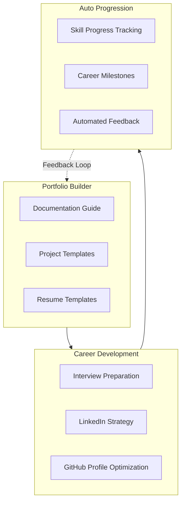

# Portfolio Career System Architecture
## Documentation | Interview Prep | LinkedIn | GitHub Profile

Comprehensive career development system for portfolio building and job readiness.

7 Portfolio Guides: Documentation, interview prep, LinkedIn, projects, GitHub, resume
Auto Progression: Skill tracking, milestone achievements, feedback loops
Outcome: Job-ready portfolio with professional presence
Module: 5_Growth_Accelerator/1_Portfolio_System
